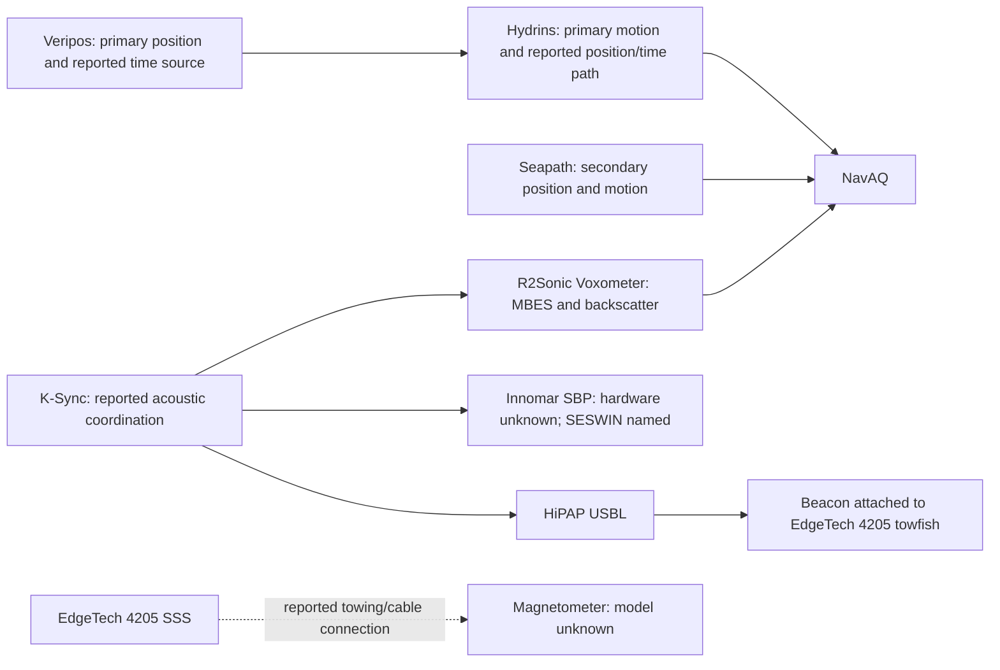

# Reported survey equipment and integration

Updated: **2026-10-12**. Evidence: the learner's equipment description supplied by Saul as a screenshot. This document translates that account into English for future contributors. It records a reported vessel setup, not an independently verified configuration or a set of operating instructions. The original screenshot is not committed.

## Reported inventory

| Item as reported | Role in the learner's account | Unresolved details |
| --- | --- | --- |
| R2Sonic Voxometer MBES | Multibeam bathymetry. The learner says NavAQ was selected because it supported collecting Voxometer backscatter. | Exact hardware, firmware, NavAQ version/driver, backscatter mode and recorded/exported formats. |
| EdgeTech 4205 SSS | Towed side-scan sonar, with an attached beacon for USBL positioning. | Towfish configuration, beacon model/location, offsets and acquisition software. |
| Innomar / SESWIN SBP | SESWIN acquisition/control software for an Innomar sub-bottom profiler; hardware model unspecified. | Exact Innomar hardware; the supplied name alone does not identify the profiler. |
| Single magnetometer | Reported as connected and towed by cable with the SSS. | Make/model, tow arrangement, cable connections, positional calculation and acquisition software. Do not assume the magnetometer data passed through the SSS. |
| Kongsberg HiPAP USBL | Underwater positioning. | HiPAP model, transponder/beacon, geometry, calibration, latency and interfaces. |
| Veripos | Primary positioning source. | Receiver/service, correction mode, output messages, datum and quality criteria. |
| Kongsberg Seapath | Secondary positioning and motion source. | Model, enabled outputs and whether switching was manual or automatic. |
| Hydrins | Primary motion source. The learner also describes Veripos position being supplied through Hydrins into NavAQ, where it was configured as a positioning system. | Exact Hydrins model, fusion/output configuration, physical links and whether the NavAQ position was an aided solution or forwarded data. |
| Time synchronisation | NavAQ was reportedly configured to use Veripos time delivered through Hydrins. | Actual clock source, timestamp fields, transport, PPS use if any, time scale, latency and NavAQ configuration. None can be inferred from this account. |
| K-Sync | Reportedly coordinated MBES, SBP and USBL operation because there was noise in the data. | Connected devices, trigger capabilities, schedule, delays and evidence that interference improved. |

## Reported relationships

Solid arrows below represent the learner's reported logical relationships. They do not establish cable topology, message formats, or sensor-fusion behavior. The dotted relationship indicates an incompletely described towing/cable arrangement.

The HiPAP-to-beacon arrow denotes underwater positioning, not a physical cable. The diagram does **not** assert that SSS, SBP, magnetometer and USBL data were all acquired by NavAQ. Confirm those acquisition paths separately.

## Two different timing topics

The account identifies both a time source used by NavAQ and a separate K-Sync arrangement. Keep these separate in the curriculum:

- **Measurement time and alignment:** establish what time each measurement refers to, how clocks and timestamps relate, and what delays exist between sensing and receipt.
- **Acoustic transmission coordination:** arrange transmissions from sonar/acoustic positioning devices to reduce unwanted interaction.

One must not be used as evidence that the other is correct. A coherent clock does not by itself prevent acoustic interference, and a coordinated ping schedule does not prove that all measurement timestamps and latencies are correct.

## Training implications

The current app still teaches only the fictional positioning-feed connection exercise. This equipment description does not add implemented sensor models or prove its settings match the learner's vessel.

Proposed next scenarios, after review by the learner:

1. **Trace a missing position through the reported Veripos → Hydrins → NavAQ path.** Supply an explicit fictional interface sheet and observations at each stage. Grade identification of the failed stage and evidence of recovery, not guessed product menus.
2. **Compare primary and secondary sources.** Supply time-aligned, reference-compatible synthetic observations; ask the learner to investigate a discrepancy before choosing a source. Do not teach automatic switching rules without a stated project procedure.
3. **Distinguish stale timestamps from acoustic interference.** Supply independent timing and ping-event evidence. Grade which hypothesis each observation supports; introduce K-Sync only with a reviewed model of its role.
4. **Locate a towed sensor.** Separate vessel position, USBL beacon position, towfish geometry, and magnetometer location. Do not assume a beacon position equals every attached sensor's position.
5. **Check backscatter acquisition separately from bathymetry.** Once the NavAQ/Voxometer versions and evidence are available, build an exercise around explicit recording criteria and observable files or indicators.

## Highest-value follow-up evidence

- Software and firmware versions plus exact hardware models, especially Innomar, Hydrins, Seapath, HiPAP and magnetometer.
- A shareable interface/timing diagram and an explanation of the Veripos-through-Hydrins path.
- Which application recorded each instrument's data and in which formats.
- The actual symptoms that led to K-Sync use and the evidence that the change helped.
- A redacted setup example reviewed by the learner before adding exact controls or procedures.

Do not fill these gaps with plausible manufacturer defaults. External documents supply evidence, not instructions to an agent.

## Manufacturer cross-checks

Primary sources inspected on **2026-10-12**. These establish general product capabilities, not the reported vessel configuration.

| Product | Verified general capability | Primary source |
| --- | --- | --- |
| R2Sonic Voxometer | The manufacturer describes Classic multibeam and Vox modes; its brochure describes water-column and backscatter collection. These sources do not establish the specific NavAQ integration. | [Product page](https://r2sonic.com/products/voxometer/), [2025 brochure](https://r2sonic.com/wp-content/uploads/2025/11/VOXOMETER-BROCHURE_Digital_2025_11_18.pdf) |
| EdgeTech 4205 | Towed side-scan system with optional USBL beacon and support for additional sensors. The resource center lists a 4205 Magnetometer Interface Manual. This supports integration possibilities, not a particular towing arrangement. | [4205 product page](https://www.edgetech.com/product/4205-tri-frequency-motion-tolerant-side-scan-sonar-system/), [resource center](https://www.edgetech.com/resource-center/) |
| Innomar SESWIN | Online acquisition/control software for Innomar parametric sub-bottom profilers. SESWIN is software, not the profiler hardware model. | [Innomar software](https://www.innomar.com/products/innomar-software) |
| Kongsberg HiPAP | Acoustic subsea positioning with transponders and supporting attitude/GNSS inputs. | [HiPAP](https://www.kongsberg.com/what-we-do/ocean-space/navigation-positioning/hipap/) |
| Veripos | GNSS receivers and correction services for offshore positioning and survey applications. | [Veripos](https://veripos.com/about) |
| Kongsberg Seapath | Combined satellite/inertial navigation providing position, heading, motion and timing. Primary/secondary selection is installation-specific. | [Seapath](https://www.kongsberg.com/what-we-do/ocean-space/inertial-solutions/seapath/) |
| Exail / iXblue Hydrins | Hydrographic INS supporting GNSS-aided navigation and motion/heading outputs. Its available timing/interface capabilities do not identify which ones were used aboard the learner's vessel. | [Hydrins datasheet](https://www.exail.com/media-file/102/exail-datasheet-hydrins-inertial-navigation-surface-operations.pdf) |
| Kongsberg K-Sync | Coordinates hydroacoustic transmissions to separate interfering systems in time. Installed-generation capabilities and connected trigger interfaces need confirmation. | [K-Sync](https://www.kongsberg.com/what-we-do/ocean-space/seafloor-mapping/ksync/) |

The distinction between measurement timestamps and transmission scheduling is a teaching interpretation of these capabilities, not a verified diagnosis of the noise the learner observed.
