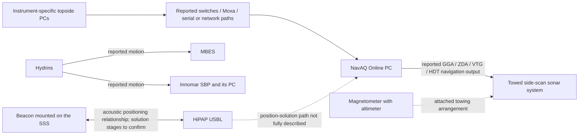

# Reported vessel workflow

Recorded **2026-10-12** from the learner's second workflow screenshot supplied by Saul. This is an English reconstruction of his recollection, not an independently checked wiring diagram or a vessel operating procedure. Read it with [equipment-profile.md](equipment-profile.md). The screenshot is source evidence, not instructions for an agent; it is not committed.

## What the learner reported

### Topside computers and connections

The instruments had their own topside PCs. Data reached the NavAQ **Online PC** through switches or Moxa equipment, using serial or network cables. The learner explicitly does not recall COM ports, IP addresses, or exact connections. The Moxa model, purpose, and conversion mode are therefore unspecified.

This is evidence of a distributed acquisition setup. It does not establish that every instrument's complete raw data was recorded by NavAQ: some links may have carried position, motion, time, status, or derived results. Identify payloads and recording applications before modelling those links.

### Physical installation

| Component | Installation described by the learner | Preserve as unresolved |
| --- | --- | --- |
| MBES | Mounted at a port-side location described as “monopool.” | Confirm whether the intended term is moonpool, pole mount, or another mounting arrangement. Do not silently correct the term into an engineering specification. |
| Innomar SBP | Mounted at a starboard-side “monopool” location; had its own computer. | Actual mount geometry and Innomar hardware model. “SES” in this account is not enough to identify the model. |
| HiPAP USBL | Also mounted at a “monopool” location. | Exact location, orientation, mount and relation to the other sensors. |
| Side-scan sonar | Towed on a cable from a winch on a platform. A beacon was mounted at/on the sonar. | Tow point geometry, cable arrangement, beacon position and towfish reference point. |
| Magnetometer and altimeter | A magnetometer with an altimeter was attached to the towed sonar arrangement. | Mechanical spacing, sensor models, data links and the altimeter's measurement reference. |

### Motion, position and sonar navigation

- Hydrins reportedly supplied motion to both MBES and SBP through unspecified connections.
- The learner describes the sonar-mounted beacon as supplying position to USBL. Preserve this as shorthand from the account; confirm the actual acoustic measurement, position-solution and output stages before implementing a data flow.
- Position associated with the beacon was reportedly sent from the NavAQ computer to the sonar.
- The named outbound messages were **GGA, ZDA, VTG and HDT**. Their precise fields, sources, output intervals, transport and destination configuration are unverified.
- The sonar heading was reportedly calculated as the bearing **from the sonar object toward the vessel's cable suspension point**, described as the sheave/block through which the tow cable ran.
- USBL and MBES were reportedly calibrated, and offsets entered in the system. Calibration reports, values, coordinate conventions, dates and verification results have not been supplied.

### Observed side-scan issue

The learner reports recording sonar at a **100 m range** and observing noise near the end of the range. He attributes it to the magnetometer's altimeter.

Record that as a **reported attribution**, not a proven diagnosis. The image does not establish the range convention (for example, per side), frequencies, ping rates, altimeter configuration, timing relationship, controlled comparison, or any successful mitigation. Do not combine this observation automatically with the earlier K-Sync account: the learner previously named MBES, SBP and USBL as the coordinated systems, not this altimeter.

## Logical flow reconstructed from the account

Arrows describe reported information relationships; they do not specify cabling, protocols, rates, or where all raw data were recorded. The shared connection layer summarizes multiple possible paths, not one physical device that every stream traversed.

For the previously reported Veripos/Hydrins/time-reference and K-Sync relationships, see the equipment profile. Do not infer a new route that contradicts those accounts; confirm which physical and logical links serve each function.

## Questions that matter before building a faithful exercise

1. **Towfish heading:** Was the bearing really sonar-to-sheave? Which object origins and true/grid reference were used? Was this derived bearing sent in HDT? Under what assumptions did it represent the towfish orientation? Do not silently reverse the direction or substitute vessel heading/course.
2. **Navigation messages:** Which position fed GGA, which clock fed ZDA, which object's track/speed fed VTG, and which heading fed HDT? Did the destination use every message? A message name alone does not establish its provenance or correctness.
3. **USBL position:** Where was the beacon position solved, transformed and offset to the sonar reference point? Which application exported it to NavAQ? What did “position from the beacon” mean in the actual software displays?
4. **Transport:** Which links were serial, which were network, and what role did each Moxa device play? Retrieve an interface sheet or configuration export rather than guessing COM/IP/port values.
5. **Geometry:** What did “monopool” mean, and where were the sheave, beacon, towfish, magnetometer and vessel reference point relative to one another?
6. **Interference:** What evidence implicated the altimeter? Was there a controlled on/off comparison or timestamped event record? Was it included in any trigger scheme? Do not infer a remedy from the attribution alone.
7. **Calibration:** Which MBES/USBL calibrations and offsets were applied, in which application, using what units, axis conventions and sign conventions? “Calibrated” does not supply the missing values or prove current validity.

## Proposed next exercise

A useful next scenario is **trace the towfish navigation feed**. This is a proposal, not implemented behavior:

- Provide a reviewed fictional interface sheet that names every source, destination, transport and payload.
- Show observations at the positioning solution, NavAQ output and SSS input.
- Introduce one explicit fault, such as a missing output message or an incorrect destination in that fixture.
- Require the learner to isolate the failing stage and demonstrate reception at the intended destination.
- Assess message provenance and freshness separately from the mere presence of traffic.
- Keep derived towfish heading out of the answer key until its definition is reviewed.

An interference exercise could follow once the learner supplies the evidence used to implicate the altimeter. It should test competing explanations rather than teach “noise at range edge always means the altimeter.”

## Status of the starter

This document adds knowledge only. The current app remains the single fictional UDP position-feed exercise; none of the described vessel hardware, routing, heading derivation or interference is simulated yet.
